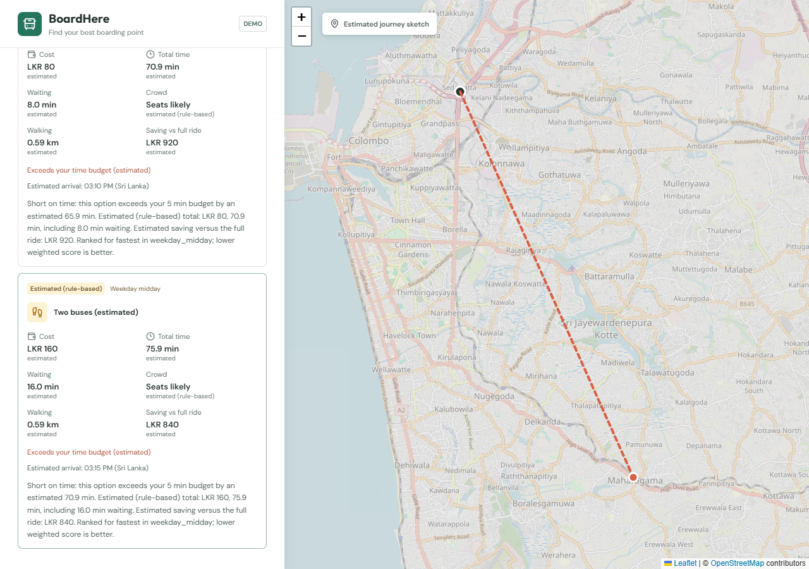
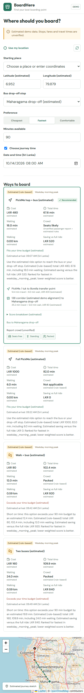
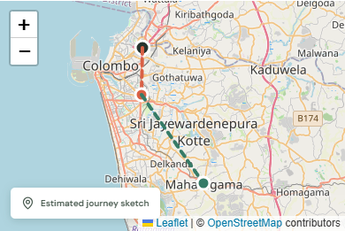

# BoardHere

A local working demo of a boarding-point guide: React -> Python FastAPI -> PostgreSQL in Docker. It compares a full PickMe ride, two buses, a PickMe hop plus a bus, and walking plus a bus. The demonstration starts at Orion City / Orugodawatta and supports Maharagama and an explicitly estimated Homagama/138 corridor.

All transport coordinates, route alignments, fares, durations, waits, and crowd levels are **estimated and unverified**. Map lines are journey sketches, not street directions. Taxi fares are scenario estimates, not quotes or bookings. This is not validated guidance for a real journey.

## Demo screenshots

Captured from the local working demo during browser checks. Transport values are estimated and unverified; map lines are journey sketches, not street directions. Map imagery is attributed to OpenStreetMap contributors in each capture.

### Desktop results

Estimated journey costs, durations, waits, walking distances, savings, and time-budget explanations alongside the map.



### Narrow-screen website

The responsive web layout includes journey controls, ranked options, and unverified crowd-report buttons. This is the website in a narrow browser viewport, not a native mobile application.



### Narrow-screen map



## Run locally

Requirements: Docker Desktop running and Node.js 22.6 or later. Python runs inside the backend container; no host Python installation is required.

```sh
npm install
docker compose up -d --wait db
npm run db:seed
docker compose up -d --build api
npm run dev
```

Open **http://localhost:5173/**. The API is at **http://localhost:8000**, its interactive documentation at **http://localhost:8000/docs**, and its database health check at `/health`. PostgreSQL is available only on localhost, port `55432`.

Choose a starting place, enter coordinates, tap the map, or use GPS with browser permission. Choose a drop-off stop, preference, and minutes available. The time override uses Sri Lanka time. Compare `08:00`, `14:00`, and `17:00` on a weekday to see the profiles change. Disable the override to use the time captured by the API for that request.

The default fixed demo date is Wednesday, 14 October 2026. All displayed transport numbers are labeled estimated. Reports submitted through the demo are unverified and use the selected journey time; future-dated reports are rejected.

Optional root `.env` values are documented in `.env.example`. `VITE_API_BASE_URL` contains only the API URL; database credentials never belong in frontend variables. The default local passwords are development-only. If port `5173` is occupied, stop the conflicting process or deliberately update both the frontend port and the API's `CORS_ORIGINS`.

## Tests

With the database started and seeded:

```sh
npm run test:database
docker compose run --rm -T --no-deps api python -m pytest -q
npm test
npm run test:web
npm run build
```

The PostgreSQL tests roll back their fixtures. API report tests remove their own inserted reports. Render tests use the existing React/esbuild tooling. The backend tests include all bucket boundaries, every preference, changed morning/midday ranking, determinism, GPS access, walk/ride/deadline rules, API errors, and the exact report-expiry boundary.

For full browser checks on Windows with Microsoft Edge installed, keep the API and frontend running:

```sh
npm run setup:browser
npm run test:e2e
```

The setup command downloads development tooling into ignored `.qa/` through the backend image. It uses installed Edge and does not install a browser. `BROWSER_EXECUTABLE` and `FRONTEND_URL` can override the defaults. On other platforms, install Playwright into `.qa/browser` and set an installed Chromium executable. Browser checks exercise nine preference/time combinations, walk/ride/tight budgets, reporting, empty/error/retry states, map overlays, desktop scrolling, and narrow web layouts. They remove their own reports and save screenshots under `.qa/screenshots/`.

## Behavior and data

- Buckets are calculated in Asia/Colombo; weekend takes precedence over night.
- Each segment has hand-set, estimated traffic multipliers, waits, and crowd levels.
- GPS walking uses haversine distance times `1.3` and estimated walking speed `4.5 km/h`.
- The nearest boardable stop must precede the drop-off in the same route pattern.
- Cost, time, crowd, and walking are normalized to `0-1` across eligible options, then weighted by preference. Lower scores rank first; ties use the option ID.
- Options fitting the available minutes rank ahead of options that exceed them. If none fit, the app says so.
- Savings are calculated from the full-ride option in the same data snapshot.
- A report younger than 30 minutes overrides that bus leg's crowd estimate. Future reports and reports exactly 30 minutes old are excluded.
- Reproducibility means identical origin, destination, preference, budget, time, and database snapshot. Responses return the resolved time and a data fingerprint. New reports are a new data input.

See [database setup](docs/database.md), [source-status sheet](docs/data-sources.md), and [rule details and roadmap](docs/rules.md).

## Stop locally

Stop Vite with Ctrl+C. Stop the containers while keeping data:

```sh
docker compose down
```

Do not add `--volumes` if you want to retain the data. `db:seed` applies pending local migrations and upserts demo fixtures without deleting reports. Applied migrations are checksum-tracked; add a new migration instead of editing one that has been applied.

## Git workflow

`main` remains the previous demo release. Completed, tested work is integrated into `develop`. Each requested group has its own branch: `feat/seed-data`, `feat/engine`, `feat/api-rules`, `feat/web`, `feat/crowd-reports`, and `chore/finish`.

Conventional commits use the configured `iamthisal` identity. Feature tests accompany their feature commits. The completed demo and group branches have been pushed to GitHub; no deployment has been performed.
